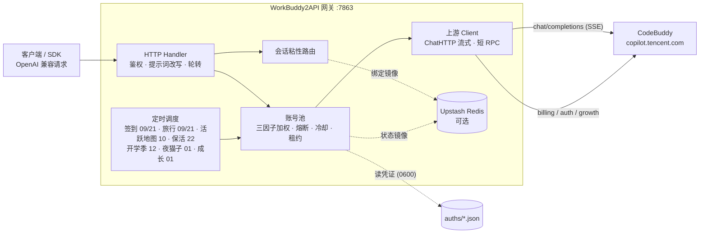

> [!NOTE]
> **延续仓库**：原上游 [Sliverkiss/workbuddy2api](https://github.com/Sliverkiss/workbuddy2api) 已于 2026-09-24 从 GitHub 消失（删除或转私有）。本仓库是其完整历史的延续副本（含上游最后的公开提交 `9a26ae7`），按原项目的 **MIT License** 继续维护，原始版权声明见 [LICENSE](LICENSE)。

<p align="center">
  
</p>

<h1 align="center">WorkBuddy2API</h1>

<p align="center">
  <b>把 CodeBuddy 账号变成 OpenAI 兼容 API 的多账号网关</b><br>
  OAuth 登录 · 账号池轮转 · 熔断与冷却 · 会话粘性 · 积分补充
</p>

<p align="center">
  
  
  
  
  <a href="https://t.me/sliverkiss_blog"></a>
</p>

---

## 项目简介

WorkBuddy2API 是一个自托管的 **OpenAI 兼容上游网关**，将 ```CodeBuddy``` 账号包装为统一的 `/v1/chat/completions` 服务。

### 交流群组
- [@checkinHome](https://t.me/checkinHome)

### 本项目做什么

- 通过 **OAuth 设备授权**（`login.sh`）获取账号凭证，在网关侧做 token 自动刷新、账号池调度与流量治理；
- 面向 **个人多账号** 场景：多账号共享、单号故障自动换号、冷却 / 熔断防止雪崩、会话粘性保证多轮上下文不跳号；
- 对客户端只暴露 OpenAI 兼容接口，现有 SDK / 前端 / 工具 **零改造接入**。

### 本项目不做什么

- **只做上游网关，不做下游协议转换** — 本项目仅负责对接上游 ```CodeBuddy``` 并暴露 OpenAI Chat 协议；Anthropic Messages、Gemini 等其他协议的适配应由下游网关负责；
- **内嵌 Web 管理面板（本分支新增）** — 吸收社区项目 [linguo2625469/workbuddy2api-panel](https://github.com/linguo2625469/workbuddy2api-panel) 的能力：内置 `/panel/` 管理面板（账号池 / 用量 / 积分构成 / 任务中心 / 模型与档位 / 在线改配置 / 运行日志），与网关同二进制、`go:embed` 内嵌、Bearer 鉴权。

### 内嵌管理面板（吸收自社区项目）

本分支已把社区面板项目 [linguo2625469/workbuddy2api-panel](https://github.com/linguo2625469/workbuddy2api-panel)（MIT）的能力整体并入：

- **Web 管理面板**：启动后打开 `http://127.0.0.1:7863/panel/`，用 `api_key` 登录；七个视图（账号池 / 用量 / 积分构成 / 任务中心 / 模型与档位 / 配置 / 运行日志），明暗主题。
- **面板内 OAuth 添加账号**：浏览器完成设备授权 → 凭证落盘 → **热加载进池（免重启）**。
- **在线改配置（热生效）**：`api_key` / `soft_rate` / 指纹脱敏开关 / 池参数 / 排程 / 积分保底 / 余额刷新间隔立即生效；`listen` / `auth_dir` / `state_file` / `server.read_timeout` / `upstream.*` / `upstash` / 会话 TTL / 归档策略需重启（保存后面板会列出）。
- **逐请求用量与请求指标**：按账号 / 模型 / 域统计 token、缓存命中、积分、延迟与吞吐；请求归档（JSONL，脱敏、可关、按天保留）。
- **运行日志环形缓冲**：网关 `log` 输出与请求流水行经 `io.MultiWriter` 镜像进面板「运行日志」页（有界缓冲，不额外占盘）。
- **积分获取历史**：各账号积分包按发放时间摊平（面额/剩余/到期/状态），与「积分构成」共用同一份上游快照。
- **成长任务中心**：全账号扫描 → 队列执行（账号内串行 / 账号间并发）→ 自动领奖；一键完成成长任务；开学季与小程序口径任务；连登管家（兑换 + 抽奖）。
- **积分保底 `credit_floor`**：账号余额低于阈值时不再接**实测收费**模型（本地成本台账 + 上游目录倍率双判据），免费/未知模型不受限；全池触底时选号返回 503 而非打穿余额。
- **暂停选号 `paused`**：运维临时让位——退出选号但签到/活跃/保活/余额刷新照常（与 `disabled` 正交）。
- **模型锁池视图**、**DSML 原生工具调用还原**、**企业号识别与额度口径**、**余额后台刷新**、**模型倍率/优惠到期展示**。
- **保留本地原有能力**：Prometheus `/metrics`、阈值告警、当日积分预算闸、账号级流量整形与全池并发闸、同号瞬时重试、任务台账/抖动/补跑、多密钥与分组、管理审计、AI 治理工作流。

新增配置面与缺省值（吸收自 panel；`logging.*` 两项缺省开启、对齐 panel）：

| 配置 | 缺省 | 说明 |
| --- | --- | --- |
| `pool.credit_floor` | `0` | 积分保底；`0` = 关闭 |
| `pool.prefer_expiring` | `true` | 最早到期积分优先路由；`false` = 退回普通权重 |
| `schedule.include_disabled_in_tasks` | `false` | 保号任务是否覆盖已禁用账号 |
| `schedule.balance_refresh_enabled` / `balance_refresh_minutes` | `true` / `5` | 余额后台刷新周期 |
| `schedule.growth_hours` / `schedule.growth_enabled` | `[1]` / `true` | 成长任务队列独立排程（panel 任务中心同管线） |
| `logging.request_archive_enabled` / `request_retention_days` / `request_archive_max_mb` | `true` / `7` / `100` | 请求 JSONL 归档与保留策略 |
| `logging.request_client_info` | `true` | 请求日志是否记录来源 IP/UA |
| `server.read_timeout` | `"300s"` | 入站请求读取上限（issue #100）；`"0"` = 不限制 |
| `server.max_body_mb` | `16` | 单请求体上限（MB）；`0` = 不限制，超限 413 |
| `upstream.model_aliases` | `{}` | 模型重定向（后缀 `*` 通配）：如把桌面端后台任务模型改写到免费模型；空 = 不启用 |
| `panel.password_hash` / `panel.session_hours` | `""` / `24` | 面板独立密码（PBKDF2 摘要，`wb2api -hash-password '<pw>'` 生成）；空 = 仅 API Key |
| `upstream.ca_bundle` / `upstream.cn_chat_base` | `""` / `""` | 额外根证书 PEM（TLS 解密代理）/ 国内上游地址覆盖（如 `https://www.workbuddy.cn`） |
| `api_keys[].models` / `api_keys[].realm` | 空 | 密钥级模型白名单（`*` 通配）与域绑定；不匹配本地 400 |
| `auth.disabled_models`（auth 文件） | 空 | 账号级禁用模型（`*` 通配），选号跳过 |
| `pool.account_fault_hold` / `account_fault_disable_after` | `"24h"` / `3` | 11140 风控处置：长冷却后自动重试，连续 N 次升级禁用；`"0"` = 立即禁用 |
| `pool.account_daily_credit_limit` | `0` | 单账号当日 credit 上限；`0` = 关闭（达到后当日不参与选号） |

### 其他社区前端面板

- [workbuddy2api-gui](https://github.com/287775856/workbuddy2api-gui) — 账号池状态可视化面板
- [workbuddy-manager](https://github.com/ithtelab/workbuddy-manager) — 账号管理工具

> ⚠️ 合规须知：本项目是**非官方**网关，使用 ```CodeBuddy``` 账号作为上游，**仅限本人授权账号、本机 / 私有环境测试**。详细边界见[安全与合规](#安全与合规)。

📖 完整文档见 [GitHub Wiki](https://github.com/Sliverkiss/workbuddy2api/wiki)。

## 核心能力

### 账号池治理

- **OAuth 设备授权登录** — `login.sh` 一条命令完成：取授权 URL → 浏览器登录 → token 轮询 → 凭证落盘 → 重启加载，全程无 PKCE（state 由服务端签发），重复执行即可连续添加多账号
- **三因子加权随机选号** — `credits 比例 ×10 + 快过期积分占比 ×8 + 闲置补偿` 三项加权（`pool.expiring_soon` 窗口内的积分优先消耗，默认 7 天），按权重降序取 **Top-5 候选短名单**，再在短名单内加权抽签（等权重候选先随机打乱防惊群、LRU 兜底覆盖全部候选），兼顾积分多、快过期积分先用掉、闲置久的账号；失败账号由熔断 / 冷却 / 连败降权状态机处置（不进权重公式）
- **防惊群** — 跳过 100ms 内刚被选中的账号，多账号同时待命时不打爆同一台
- **在途租约** — 单账号最大在途请求数（`pool.max_in_flight`）限制并发占用，占满的号不参与选号，避免单号过载
- **账本择优** — 每次成功请求按 `usage.credit` 折算每千 token 单价记入 `(账号, 模型)` 账本，免费 / 便宜的账号优先；观测按 EMA 平滑、6 小时未更新即失效（陈旧价格不复活），成本随上游活动实时变化；账本随池状态落盘 `state.json`，重启不丢学费；`/status` 透出 `model_costs` 台账（模型 / 单价 / 末次观测 / 样本数）
- **成本分层条件探索** — costTier 硬过滤（免费 > 未知 > 收费）会把全池锁死在唯一的实测免费号上：其余账号永远轮不到、也就永远学不到「它其实也免费」（垄断 + 学习冻结，issue #136）。破解方式是**搭车改道**：tier 0 垄断层存在且 tier 1 有成员时，距上次探索 ≥ `pool.cost_explore_interval`（默认 30m，`"0"` 关停）就把本次选号改道给一个未知号——承接的是完整真实用户请求，**零新增上游请求**（IP 维度零增量，WAF 友好）。成功即毕业（首观测入账，免费回 tier 0 / 收费出局 tier 2，学费只付一次）；失败走既有冷却 / 熔断策略，无探测风暴。探索频率硬性限幅 ≤ 48 次 / 天 / 模型（24h ÷ 30m），与池规模和 QPS 无关；tier 1 枯竭后自动停探。探索节奏按 `(域, 模型)` 独立；`/status` 透出 `cost_explore` 台账（累计事件数 + 各 (域, 模型) 最近探索时刻），与 `model_costs` 行对照即可读出「探索 → 毕业」全链路

### 流量治理

- **分级熔断与冷却** — 429 软冷却（600s 起指数退避、封顶 `soft_rate_max`）、404 固定浅冷却、402 / 余额耗尽硬冷却至次日 04:00、连续失败熔断（`breaker_threshold` 触发后指数退避封顶 6h）
- **模型级限流独立冷却** — 6004（该模型使用量超限）只冷却触发调用的模型，切其他模型立即可用；`/status` 透出 `rate_limited_models` 台账
- **当日积分预算闸**（`budget.daily_credit_limit`，缺省 `0` = 不限）— 给「跑飞的客户端 / 忘了关的脚本」装一道钱闸：当日累计扣费达到上限后，网关直接拒掉后续对话请求（`429` + `daily_budget_exceeded`，错误文案带上已用与上限），把积分损失截断在阈值附近。计数按 **CST 自然日**重置（与上游增长体系同口径），进程内不落盘、重启清零。只统计上游 `usage` 给出 `credit` 的请求（缺观测不计入，与成本账本同一纪律），所以当日用量是一个**下界**、真实日耗只会更多——阈值宜按保守值设；也可以先留 `0` 当观察模式跑几天，看 `/status` 里 `daily_budget.used` 的真实日耗再定值。闸在**读请求体之前**判定（被拒的请求不会被白读进内存），且**不改变选号**——它只决定「这一枪开不开」，不做「换便宜号」的降级。实时台账（当日已用 / 上限 / 当日被拒次数 / 归属日）在 `/status` 的 `daily_budget`
- **账号临时停用 / 恢复** — 运维可把某个号临时摘出选号池、观察后再放回，不必删凭证（issue #138/#118）。语义是「对话流量摘除」而非「账号冻结」：停用期间签到、token 保活、排程任务照常执行，账号仍在池里、状态照常透出。与系统自动禁用是**两个独立状态位**（`manual_disabled` / `disabled`），各自清除、都清空才回到选号池——避免运维意图被签到解冻等自动复活路径意外解除；停用状态随池状态落盘，重启保留。入口：`/admin/accounts/{uid}/{disable,enable,revive}` 端点 + `cmd/acct` CLI（默认关闭，`admin.enabled` 显式开启）
- **上游同号瞬时重试**（`upstream.retry_*`，缺省关闭）— 开启后聊天 SSE 对**仅 5xx 与传输层失败**按 `retry_attempts`（默认 1，钳 [1,5]）次同账号重试，指数退避（基数 `retry_backoff` 默认 0.5s，封顶 8s + ±25% 抖动）。429/402/401/403 等**永不重试**——配额重试只会更快被限、凭据问题重试不会变得有权限。默认关闭（重试放大上游压力）；重试耗尽后回到既有换号轮转
- **账号级流量整形**（`pool.weight_default` / `pool.max_concurrency_default` / `pool.min_interval_default`，全部缺省 0 = 不限）— 每个账号可在 auth 文件写 `weight`（选号权重乘子，显式 `0` = 只读备用不参与轮转，缺省回落池级默认 1.0）、`max_concurrency`（单号并发上限，优先于 `max_in_flight` 分档）、`min_interval`（两次请求最小间隔秒）。三者都在选号时软生效：全被限住时回落 LRU 兜底，不报「暂无可用账号」
- **全池并发闸**（`pool.max_total_concurrency`，缺省 0 = 不限）— 单号并发上限治不了「每号都没超、整体太猛」：20 号 × 3 并发 = 60 同时在途。顶满时本次选号回 503，请求排队而非失败
- **状态持久化** — 池状态（积分 / 冷却 / 熔断 / 计数）本地原子落盘 `state.json`，可选镜像至 Upstash Redis，重启后择优恢复

### 可观测与告警

- **Prometheus 指标端点**（`metrics.enabled`，缺省关闭）— 开启后暴露 `GET /metrics`（Prometheus 文本格式 0.0.4），一次抓取即可拿到账号池规模与各状态分布、在途请求数、会话粘性绑定数、成本探索累计触发次数、WAF IP 拦截是否生效，以及按模型的请求数（成功 / 失败）、流式请求数、token 与缓存 token（命中 / 未命中 / 写入）、积分消耗、首字节与端到端平均耗时、生成吞吐（`wb2api_model_tokens_per_second` 带 `samples` 标签同报观测样本量）。池维度按 realm（`cn` / `global` / `all`）拆分，指标名与标签值固定顺序输出，逐次抓取结果稳定可比、对不上口径时能直接 diff。口径与 `/status` 同源（同一次聚合，不存在两套数），只暴露聚合量——不含账号 uid、token 等敏感维度；开启后仍受 `api_key` 鉴权保护，与 `/status` 同级。另有 `wb2api_task_*` 一族，输出每类定时任务的**最近一轮**（执行时间戳、各结果计数、是否全灭），只对跑过的任务输出序列
- **可用性阈值告警**（`alerting.enabled`，缺省关闭）— 开启后按 `alerting.interval_seconds`（默认 30s）周期评估池健康度，越界即向 `alerting.webhook_url` 投递 JSON；填 `alerting.secret` 则对请求体做 HMAC-SHA256 签名（`X-WB2A-Signature` 头），接收端可校验来源。四类规则：**健康账号数不足**（按域分别设阈值，`min_healthy_cn` 默认 1、`min_healthy_global` 默认 0 = 不评估该域，纯 CN 部署不会因国际版为空而常驻误报）、**熔断账号数超限**（`breaker_threshold`，默认 0 = 不评估）、**WAF IP 拦截生效**（旋转失败的快速失败信号）、**连续失败预警**（`min_consecutive_fails`，默认 3，0 = 关闭；统计熔断连续失败计数 ≥ 阈值的账号数，**≥1 即告警**——存在性语义，与「熔断账号数超限」互补：本规则在熔断边界同步发出）。触发是**边沿触发**：连续满足 `alerting.for_ticks` 拍才投递一次，持续越界期间不重复刷屏；恢复需连续满足 `alerting.clear_ticks` 拍才解除（迟滞防抖），解除后可再次触发，不会在临界点来回抖动。`alerting.startup_grace_seconds`（默认 30s）内不评估，避开启动初期账号尚未同步的空池假告警；`alerting.send_resolve` 可额外投递恢复通知。投递超时（`alerting.timeout_seconds`，默认 5s）不阻塞主流程，通知内容不含任何凭证
- **管理操作审计**（`admin.audit_enabled`，缺省关闭）— 开启后 `/admin` 下每个动作（账号停用 / 恢复 / 复活、手动补跑任务）都向 `admin.audit_file`（默认 `./data/admin_audit.log`）追加一行 JSONL，记下**何时、对谁、做了什么、结果如何、从哪来**：时间戳、动作名、对象（账号 uid 或任务名）、响应状态码、来源 IP、`api_key` 指纹，以及停用时填写的理由。用来回答「这个号是谁停的、什么时候停的、为什么」——池状态里的 `manual_reason` 只保留**最新**一条，改动历史只在这里。几处刻意取舍：**只记通过鉴权的请求**（匿名探测不落盘——否则任何人都能靠刷 `/admin` 写满运维的磁盘）；**`api_key` 只存不可反推的指纹、不存原文**；**每条记录独立开-写-关**，故外部 `logrotate` 轮转后进程会自动写新文件，不会继续写进已被移走的旧文件而静默丢失；**审计写失败只告警、不失败请求**（磁盘满时管理操作照常完成——操作结果本身已落在池状态里，而「审计写不进去就拒绝操作」会把一次磁盘故障升级成「坏账号摘不掉」）。路径不可写会在**启动时**直接报错退出，不拖到第一次管理操作才发现。需与 `admin.enabled` 同时开启（审计的对象就是这些端点）

### 请求链路

- **流式 + 非流式** — 出站强制 `stream:true`；SSE 帧按 OpenAI 规范白名单重建；非流式由本地聚合为单响应
- **DeepSeek 思维链注入** — 出站请求体注入 `thinking.type=enabled` + 默认档位，`reasoning_content` 多轮回填，`reasoning_effort` 按模型档位自动降级
- **系统提示词三模式**（`prompt.mode`，缺省 `passthrough`） —
  - `passthrough`（缺省）：透传客户端原始 system，遇内容拦截自动降级中性提示词重试
  - `custom`：网关用自有提示词**替换**客户端 system/developer（从源头消除模板句误报；不参与降级）
  - `append`：**两者并用**——开头连续 system/developer 块之后插入网关自有提示词，客户端项目规范/工具约定与网关人格共存（issue #129）；降级期与拦截首遇重试时退化为 `custom` 语义（换中性提示词，原文 system 移除）
  - `prompt.file`（custom/append 生效）指向自定义提示词文件，空 = 内置默认
- **会话头族注入** — 出站携带官方客户端会话头族（`X-Conversation-Request-ID` 聚合主键 · `X-Conversation-ID` 透传，客户端缺省会话 ID 时用轮级聚合键兜底合成、**该头恒发**（上游渠道校验要求，缺头会被判非官方客户端并拒收，见 #36） · B3 链路），轮转 / 重试 / 路径回退复用同键，后台按对话轮聚合不再碎片化（issue #35）
- **指纹脱敏** — 出站请求体黑名单指纹字段清洗（可开关），与提示词体系两层叠加

### 选号语义

选号 = 会话粘性（命中即定）→ 成本分层（硬过滤）→ 加权随机（软均衡）三层串联，各层语义：

- **成本分层** — 账本把每个 `(账号, 模型)` 归入三档：**tier 0**（实测免费，单价 ≤ 0）、**tier 1**（无观测）、**tier 2**（实测收费）。同一次选号在**存活的最便宜档内**选：有 tier 0 就只在 tier 0 里挑，全池无免费观测才落到 tier 1，再不行才是 tier 2——即「贵号永远只作兜底」。tier 1 的号**不会被跳过**：新账号 / 新模型没跑过就没有观测，直接淘汰会把新号饿死。观测随 `usage.credit` 实时更新且 6 小时过期，所以限免窗口（如夜间免费）一结束，账号回到 tier 1 / tier 2，选号自动跟随——无需重启，日志会打 `free tier ended` 提示价格切换
- **会话粘性** — 同一对话固定走同一账号（多轮上下文不跳号、上游 prompt cache 不碎）。粘性键按此优先级取：**conversation 维度四键**（`metadata.conversation_id` / `metadata.conversationId` / `conversation_id` / `conversationId` 任一）→ **`prompt_cache_key`**（pi-ai 系客户端把会话 ID 放在这个 OpenAI 前缀缓存字段里）→ **首条 user 消息文本的 sha256 兜底**（OpenAI 兼容协议无会话 ID 字段，dsh / Codex 等客户端四键全缺，此前粘性恒不命中、逐请求换号；现由首条 user 消息派生会话级稳定键——会话内历史追加不影响该键，开新会话自然换键）。`user_id` **不是**粘性键——它会把一个用户的所有并行对话钉到同一个号上（粒度远粗于上游对话级缓存边界），发 `user_id` 的客户端回落加权轮换（**该回落同样适用于首条 user 消息兜底**：请求体带 `metadata.user_id` 或顶层 `user_id` 时不派生兜底键）。绑定 30 分钟滚动续期，空闲即过期释放
- **负载分布** — 粘性与分层都未限定时，三因子加权随机（`credits ×10 + 快过期积分 ×8 + 闲置补偿`）把流量摊开：高余额号多扛、快过期积分的号先用、闲置号补位；防惊群跳过 100ms 内刚选中的号。权重是**概率倾斜**而非硬排序（Top-5 短名单 + 名单内抽签），不会让单一账号垄断流量

### 定时积分任务

- **签到**（09 / 21 点）— 每日签到 + 余额查询，余额恢复自动解冻冷却账号
- **活跃地图**（10 点）— 对话事件连发上报点亮活跃地图与连登天数、解锁领养前置，补签卡保连登、连登档位兑换 + 抽奖、礼包/补偿领取，回读 streak 自检
- **猫猫旅行**（09 / 21 点）— 独立排程：领养 / 派出 / 领奖闭环推进
- **token 保活**（22 点）— 全账号刷新 token，session 失效连续 3 次才禁用
- **开学季任务**（12 点）— 任务点亮 + claim + 自动抽空抽奖余额，活动下线时自动跳过
- **夜猫子任务**（01 点）— 夜猫窗口（23:00–08:00 CST）内补一次 black_cat（Go 原生，无 python 依赖）
- **成长任务队列**（01 点）— panel 任务中心同管线：全账号扫描 → 队列执行 → 自动领奖（`schedule.growth_*`）

七类任务独立排程、独立开关（`schedule.*_enabled`），互不影响。

**触发时刻可抖动**（`schedule.jitter_minutes`，缺省 `0` = 精确整点）：各任务时点默认精确落在整点（迁移自系统 crontab 的 `0 9 * * *` 语义），于是每次到点都是整点齐发。设为正值后，每类任务的触发时刻在该窗口内取一个偏移，把负载摊开、对 WAF 更友好；窗口按**分钟**计，例如 `30` 表示实际触发落在名义时点之后 0–30 分钟内。偏移是**确定性**的——同一任务、同一天、同一小时永远得到同一个偏移（按「任务名 + 日期 + 小时」散列派生），因此不会重复触发同一个时点，重启后当天的节奏也保持一致；换一天则换一个偏移，不会形成新的固定规律。**注意默认种子不含实例身份**：同一任务、同一天、同一小时下，所有用同一份配置的部署会算出**同一个**偏移——整点齐发只是被平移成一个固定的新齐发点。想让各部署真正错开，把 `schedule.jitter_salt` 设成各部署不同的字符串（缺省空串 = 与引入该字段前逐字一致，零行为变化；非空时参与散列，仅影响偏移取值）。窗口大于相邻时点间隔时（如 9 点与 10 点相隔 60 分钟），任务的实际先后可能与配置的小时顺序不一致——这是摊开负载的必然代价。

**错过窗口可手动补跑**：窗口被错过时（服务刚重启、上游当时抖动、刚加完号）不必干等到下一个整点——`POST /admin/tasks/{name}/run`（`name` ∈ `checkin` / `activity` / `keepalive` / `travel` / `school` / `cat`）立即受理并让网关在后台补跑一次。受理是**异步**的（回 202，命令不等任务跑完——这些任务遍历全池打上游、脚本类任务还会起 python 子进程，耗时可达分钟级），进度看网关日志；同一任务已有一趟在跑时回 409，避免连点对上游重复写。**零上游增量**：只是把既有任务提前跑一次，不新增任何自动上游请求。需 `admin.enabled`（与账号管理端点共用开关与 `api_key`），入口另有 `./acct.sh task <name>`。

**任务执行台账**（`schedule.ledger_file`，缺省空 = 只在内存）：每类任务跑完一轮都记一笔——触发来源（`schedule` 定时 / `retry` 自动补跑 / `manual` 人工）、起止时刻与耗时、本轮涉及多少账号，以及其中成功 / 已做过 / 失败 / 跳过各多少，外加「本轮是否全灭」。`/status` 的 `task_ledger` 段（`runs` + `retry`）直接读它，于是「昨天 21 点的签到到底跑没跑、跑了几个号、失败几个」不用再翻日志；`/metrics` 也据此输出 `wb2api_task_last_run_timestamp_seconds`、`wb2api_task_last_run_accounts{kind,result}`、`wb2api_task_last_run_all_failed`（只对跑过的任务输出序列——否则每次部署都会多出一条「从未跑过」的假告警）。填了路径就顺带落一份 JSON 文件，重启后仍能看到上一轮结果；**写盘失败只打日志、不拦任务**——台账是观察，不是安全承诺，这一点与 admin 审计日志的 fail-fast 刻意相反。计数按 CST 自然日滚动，跨日后的下一次访问自动归零。

**当日失败重试**（`schedule.retry_delay_minutes`，缺省 `0` = 关闭；`schedule.retry_max_per_day`，缺省 `1`）：一轮跑完**有失败且一个都没做成**（`ok + already == 0`）时，视为上游整体不可达（网络/DNS 未就绪、上游抖动、WAF 拦截），延迟 `retry_delay_minutes` 分钟自动补跑一次。判据刻意**不是**「失败率超阈值」：只要还有账号成功就证明上游是通的，失败是账号级的（单号 token 过期、被限流），重试只会对同一批注定失败的号再打一遍上游——既无收益，又正好撞在本仓库一直避免的风控上。`retry_max_per_day` 是每类任务的**当日上限**，计数在**排定时**就 +1（不是跑完才 +1），所以重试排上之后即使服务重启也不会重复排、更不会对上游重复写；达到上限或延迟跨到了次日，只打一条 WARN 说明原因。人工触发（`/admin/tasks/{name}/run`）**不排重试**——运维刚点过一次，自己会判断要不要再点，自动重跑会让一次人工操作静默变成两次上游写。**缺省关闭，且开启后成功路径依旧零新增上游请求。**

### 双域适配

- 同时适配**国内版（CN，`copilot.tencent.com` / `www.codebuddy.cn`）与国际版（Global，`www.workbuddy.ai`）**账号
- 共享同一账号池，由账号 `realm` 或请求模型名前缀（`cn:` / `global:`）决定路由；`global.enabled` 可一键锁死纯 CN 部署
- 国际版支持注册激活、地区完善、一次性 trial 加油包领取（`./trial.sh`）

### 产品 profile、图片策略与工具端点（2026-10 迁移）

- **产品 profile**：账号可显式声明 `profile`（`cn-cli` / `cn-work` / `intl-cli` / `intl-work`），
  或由 `profile_derived`（需 `profile_backfill_v1=true`）/ realm / domain 推导。只有
  `profiles.enabled=true` 且 `profiles.detect_only=false` 时才按 profile 路由；其余组合
  逐字走迁移前的 `chatBase` / `globalOn` 路径。`global.enabled=false` 时 `intl-*` 强制回落
  `cn-*`（逃生门不得被 profile 绕过）。
- **图片策略**：`upstream.max_images`（0 = 不限）+ `upstream.image_policy`
  （`passthrough` / `truncate` / `error`）+ `upstream.capability_guard`（模型目录显式声明
  不支持图片时提前 400）。默认全关。
- **搜索 / MCP**：`POST /v1/search`（query + max_results 1–10）与 `POST /v1/mcp`
  （JSON-RPC 2.0：`initialize` / `tools/list` / `tools/call`，工具 `web_search`）。
  默认关闭；每上游 key 600/min；带 `Origin` 头一律 403；无会话状态。
- **鉴权头**：`X-WB2A-Realm` / `X-WB2A-Profile` 只用于 search/MCP；chat 仍按密钥
  realm + 模型前缀校验。

core 侧相关 flag（默认值，改 `config.json` 后重启）：

| flag | 默认 | 说明 |
|---|---|---|
| `upstream.max_images` | `0` | 单请求图片上限，0 = 不限 |
| `upstream.image_policy` | `passthrough` | `passthrough` / `truncate` / `error` |
| `upstream.capability_guard` | `false` | 图片能力预检 |
| `profiles.enabled` | `false` | 产品 profile 路由总开关 |
| `profiles.detect_only` | `true` | 只写字段，不改变 URL / 选号 |
| `search.enabled` | `false` | `/v1/search` 是否存在 |
| `mcp.enabled` | `false` | `/v1/mcp` 是否存在 |

### 辅助工具

- 积分日报：`./credit.sh`（美化 / `-json`，realm 感知双域）
- 手动签到：`./signin.sh`（批量、幂等不重复计）
- 账号停用 / 恢复：`./acct.sh list | disable <uid> [原因] | enable <uid> | revive <uid>`（需 `admin.enabled`，走网关管理端点）
- 手动补跑排程任务：`./acct.sh task <任务名>`（异步受理，同任务在跑时回 409；需 `admin.enabled`）
- 智能体一键配置：`go run ./cmd/agentcfg -client <claude-code|codex|opencode|crush|zcode> -base-url <url> -api-key <key> -model <id>`（写入前备份，`-restore` 还原，`-dry-run` 只预览；状态目录 `~/.wb-agent-config`）
- 领养联动 / 任务查询：`scripts/task_runner.py`（成长任务一体机，默认 dry-run）
- 个性化提示词：`prompt.file` 指向自定义提示词文件即整体替换内置默认（`custom`/`append` 模式生效）

### 仓库自动化（AI 治理）

仓库的 issue / PR 由 `.github/actions/ai-governance` 自动分级与归并：垃圾检测、README 覆盖检查、
分类打标、要点提炼、canonical 归并；PR 侧另有关联记录与历史语境评审。AI 后端用仓库 Secrets
`AI_BASE_URL` / `AI_API_KEY` / `AI_MODEL` 指向任意 OpenAI 兼容端点。

> **提 PR 前请看 [贡献与 PR 要求](#贡献与-pr-要求)**：本仓库的 PR 会被 AI 自动打标、规范化标题、
> 关联 canonical，**通过闸门后会直接自动合并**；不满足要求的会被判 `TRIVIAL` / 垃圾并自动关闭。

- **自动审核**：PR 创建时自动跑垃圾检测、标题规范（Conventional Commits）、质量判定、分类打标、
  历史语境评审，并在正文顶部追加自动维护的关联块（`<!-- ai-governance:linked -->` 锚点，请勿删除）。
- **自动合并**（`enable-auto-approve`）：通过闸门的 PR（分层检测 KEEP + 改动不含 CI / 构建 / 依赖 /
  脚本类文件 + 规模在上限内）会被打上 `ai-approved` 标签，由 `PR Auto-merge` 工作流启用仓库原生
  auto-merge —— **必须在 PR CI（`test` 检查）通过后才合并**；PR 有新提交会自动撤销批准，需重新评审。
  维护者叫停：摘掉 `ai-approved` 标签并关闭 auto-merge 即可。
- **人工重跑**：Actions → AI Governance → Run workflow，填 `issue-number` 或 `pr-number`（二选一）
  即可对既有内容重跑同一条治理链路；两者都留空时只告警、不做任何处理。
- **维护者豁免**：`maintainer-exempt`（默认开）让协作者提交的内容跳过归并 / 重开与自动合并，
  只保留垃圾检测与分类打标。
- **先行演练**：`dry-run` 只评论不写入，用于上线前观察判定质量。

## 架构总览



上游请求在出站前经历统一的改写管线（`internal/upstream/payload.go`）：强制 `stream:true`、`developer` 角色归一、tool_choice 归一、`image_url` 字符串兼容为 OpenAI 对象形态、DeepSeek 思维链注入、`reasoning_effort` 档位降级、`reasoning_content` 回填、指纹脱敏。

## 快速开始

### 环境要求

- **Docker + Docker Compose**（推荐部署方式，镜像内已含 `app` 低权限用户与全部工具脚本）
- 一个或多个已注册的 CodeBuddy 账号，用于 OAuth 登录
- 宿主机 Go ≥ 1.22（仅源码构建时需要）

### Docker Compose 一键部署

```bash
git clone https://github.com/Sliverkiss/workbuddy2api.git
cd workbuddy2api
cp config.example.json config.json
```

编辑 `config.json`，**至少设置 `api_key`**（`留空 = 不鉴权`，公网部署务必设置）。示例中的 `test_key` 等均为占位符，`config.example.json` 不含任何真实密钥。

```bash
# 登录添加账号（重复执行可加多号；注意：执行过下方说明中的 chown 后，
# host 侧 login.sh 会被可写性预检拦截——此时请在容器内登录，见下方说明）
./login.sh

# 启动服务
docker compose up -d --build

# 健康检查（无可用账号时 503）；service 字段用于确认打到的是本网关
curl -s http://localhost:7863/healthz
# {"healthy":2,"total":3,"service":"workbuddy2api"}
```

`login.sh` 内置授权 URL 获取 + 浏览器登录 + token 轮询 + 首次签到 + `auths/workbuddy-<uid>.json` 落盘 + 容器重启，全程无 PKCE（state 由服务端签发）。账号池在容器启动时用 `auths/` 目录自动对齐，新增凭证文件即自动发现。

> **国内网络下构建会卡在第一层**：镜像构建的第一步是 `go mod download`，默认走官方
> `proxy.golang.org` —— 中国大陆不可达，表现为长时间停在这一层（看着像构建挂了），
> 有时直接失败。换个国内代理即可：
>
> ```bash
> docker compose build --build-arg GOPROXY=https://goproxy.cn,direct
> docker compose up -d
> ```
>
> 也可以直接填进 `docker-compose.yml` 的 `build.args.GOPROXY`。留空 = 官方默认，
> 与改动前行为一致。

> **非 root 宿主用户注意**：`./login.sh` 以**当前宿主用户**落盘凭证（权限 0600），而容器内网关以 `app(uid 10001)` 读 + 回写（refresh / realm 补标识走 tmp+rename，需要目录写权限）。二者 uid 不同（例如 Linux 非 root 账号通常是 uid 1000）时容器读不到凭证文件，`/status` 账号数为 0——与 `./data` 卷的属主问题同源。登录后、启动前把目录属主交给 10001（root 或部署用户执行）：
>
> ```bash
> chown -R 10001:10001 ./auths
> ```
>
> 之后新增账号**必须**进**容器内**登录（`app` 自身落盘，属主即 10001，无需反复 chown；chown 后 host 侧 `./login.sh` 无写权限，脚本会在启动浏览器授权前直接退出并提示，不会白走一遍 OAuth。容器内无 docker CLI，完成后回宿主机重启）：
>
> ```bash
> docker compose exec -it wb2api bash -c './login.sh' && docker compose restart wb2api
> ```

### 源码构建

```bash
go build ./...
go vet ./...
go test ./...      # 完整测试套件
go run ./cmd/server -config config.json
```

构建二进制：

```bash
CGO_ENABLED=0 go build -trimpath -ldflags="-s -w" -o wb2api ./cmd/server
CGO_ENABLED=0 go build -trimpath -ldflags="-s -w" -o signin_bin ./cmd/signin
CGO_ENABLED=0 go build -trimpath -ldflags="-s -w" -o login ./cmd/login
CGO_ENABLED=0 go build -trimpath -ldflags="-s -w" -o credit ./cmd/credit
```

#### Windows 原生运行（无需 Docker）

Windows 10/11 自带的 PowerShell 与 `curl.exe` 即可管理后台进程。先准备配置并构建：

```powershell
Copy-Item config.example.json config.json
# 编辑 config.json；建议把 listen 设为 127.0.0.1:7863，且务必设置 api_key

go build -trimpath -ldflags="-s -w" -o wb2api.exe ./cmd/server
go build -trimpath -ldflags="-s -w" -o login.exe ./cmd/login
go build -trimpath -ldflags="-s -w" -o signin_bin.exe ./cmd/signin
go build -trimpath -ldflags="-s -w" -o credit.exe ./cmd/credit
```

使用仓库自带脚本在后台启停并查看状态：

```powershell
.\start-workbuddy2api.cmd
.\status-workbuddy2api.cmd
.\stop-workbuddy2api.cmd
```

PID 写入 `wb2api.pid`，标准输出与错误日志分别写入 `data/server.out.log`、
`data/server.err.log`。停止脚本会先验证 PID 对应的可执行文件确为当前目录下的
`wb2api.exe`，不会因陈旧 PID 误杀其他进程。

添加账号可使用配套管理面板，或在 Git Bash 中运行现有 `login.sh`（它还负责 CN
首次签到以及 Global 注册地区/trial 流程；不建议只手工调用 `login.exe` 后跳过这些步骤）。

### 验证

```bash
# 模型列表
curl -s http://localhost:7863/v1/models -H "Authorization: Bearer your-api-key"

# 账号状态（汇总 + 每账号详情，含 disabled / manual_disabled 双位）
curl -s http://localhost:7863/status -H "Authorization: Bearer your-api-key"

# 临时停用一个账号（需 config 里 admin.enabled = true）
curl -s -X POST http://localhost:7863/admin/accounts/<uid>/disable \
  -H "Authorization: Bearer your-api-key" -H "Content-Type: application/json" \
  -d '{"reason":"观察几天"}'
# 或用 CLI（自动从 config.json 读网关地址与 key）
./acct.sh list && ./acct.sh disable <uid> 观察几天 && ./acct.sh enable <uid>

# 流式聊天
curl -sN http://localhost:7863/v1/chat/completions \
  -H "Authorization: Bearer your-api-key" \
  -H "Content-Type: application/json" \
  -d '{"model":"deepseek-v4-flash","messages":[{"role":"user","content":"hi"}],"stream":true}'

# 非流式聊天（本地聚合）
curl -s http://localhost:7863/v1/chat/completions \
  -H "Authorization: Bearer your-api-key" \
  -H "Content-Type: application/json" \
  -d '{"model":"deepseek-v4-flash","messages":[{"role":"user","content":"hi"}],"stream":false}'
```

<<<<<<< HEAD
## 致谢与出处（本分支新增能力）

本分支的以下能力吸收自社区项目 **[linguo2625469/workbuddy2api-panel](https://github.com/linguo2625469/workbuddy2api-panel)**（MIT License，原始版权声明见其仓库 LICENSE）：

- `internal/panel`（Web 管理面板）、`internal/usage`（用量统计）、`internal/reqlog`（请求指标与归档）、`internal/livecfg`（运行期配置快照）、`internal/httpauth`（常量时间鉴权）；
- 上游增强：成长任务链（`tasks.go` / `desktop.go` / `streak.go` / `school.go` / `blackcat.go` / `profile.go`）、DSML 工具调用还原（`dsml.go`）、企业号额度（`enterprise` 口径）、模型倍率与优惠、签到/余额瞬时重试；
- 池与调度增强：`paused` 暂停选号、`credit_floor` 积分保底、模型锁池视图、连登管家、余额后台刷新、`include_disabled_in_tasks`、企业号门控。

按 MIT 协议，再分发（源码或二进制形式）时须保留原仓库的 MIT 版权声明与许可声明。

## 贡献与 PR 要求

**本仓库的 PR 由 AI 自动审核，并在通过闸门后自动合并。** 提交前请按下面的自查清单过一遍 ——
这些要求不是礼节，而是流水线的实际输入：不满足大概率会被判 `TRIVIAL` / 垃圾而自动关闭，
或拿不到自动合并资格（只能等人工）。

### 会自动化发生的事（先知道这些）

| 环节 | 行为 |
| --- | --- |
| 触发 | **只在 PR 创建时**自动评审一次；之后改标题、追加提交都不会自动重跑 |
| 打标 | 自动打一个分类标签（`bug` / `enhancement` / `question` / `documentation`） |
| 改标题 | 标题不符合 Conventional Commits 时**会被 AI 改写**（如 `feat(scheduler): …`） |
| 改正文 | 在正文顶部追加自动维护的块（要点 + 关联的 canonical issue，带 `<!-- ai-governance:linked -->` 锚点）；**请勿删除锚点行**，也不要手工重复它 |
| 关闭 | 垃圾 / 恶意内容 → 关闭并**锁定**；只有测试、无意义或纯占位的改动 → 判 `TRIVIAL` 关闭（不锁定）；与历史结论冲突（重复已合并、或维护者已 wontfix 的改动）→ 附历史依据关闭并打 `history-rejected` |
| 合并 | 通过闸门的 PR 由**仓库原生 auto-merge** squash 合并进 `master`；提交信息取 PR 标题，所以标题要写成一句人话 |
| 身份 | 以上动作由 `github-actions[bot]` 执行。不同意判定就在 PR 下留言并 @ 维护者 —— 维护者可摘掉标签、关闭 auto-merge、或重跑治理 |

### 自动合并的闸门

只有**全部满足**才会被自动合并；缺任何一条都只走人工：

1. **分层检测 `KEEP`**：非垃圾 + 标题符合 Conventional Commits + 质量 `VALID`；
2. **不含敏感路径**（这类改动永远人工合并，绝不自动合）：
   - `.github/**`（CI / 工作流 / Action）—— 自动合并这类改动等于把仓库执行权限交给贡献者；
   - `Dockerfile`、`docker-compose*.yml`、`Makefile`；
   - `go.mod`、`go.sum`（依赖与构建图）；
   - `scripts/**`、任意 `*.sh` / `*.cmd` / `*.ps1`；
3. **规模在上限内**：≤ 20 个文件且 ≤ 800 行改动（超过就只做人工评审）；
4. **CI 绿**：`PR CI` 的 `test` 检查通过 —— 它已设为 `master` 的必需检查，auto-merge 会等它；该工作流走 `pull_request_target`，**来自 fork 的提交也会自动跑，不需要维护者批准**；
5. **不是草稿**，且作者不是维护者 / 协作者（协作者的 PR 只做检测与打标，不走自动合并）。

拿到 `ai-approved` 并启用 auto-merge 之后，**再推一次提交就会撤销批准**（重新评审：
Actions → AI Governance → Run workflow，填 `pr-number`）—— 所以尽量一次改完再提。

> `PR CI` 走 `pull_request_target`，工作流定义固定取默认分支上的那一份：来自 fork 的运行**不需要**
> 维护者批准就能上报 `test`。此前 fork 首次贡献会被 GitHub 挂起等人工点「Approve workflows to run」，
> 那段时间 `test` 永不出结果 —— 即使 `ai-approved` 已打、auto-merge 已启用也只能无限等待，现已不存在。
> 代价是 fork 的代码会自动在 runner 上执行：只有只读 `GITHUB_TOKEN`、不引用任何 secret，且 PR 改不动 CI 定义本身。
> 该事件默认还**禁止检出 fork 的代码**（`actions/checkout` 会直接报 `Refusing to check out fork pull request code`），
> 工作流里显式放行（`allow-unsafe-pr-checkout: true`）—— 放行的前提正是上面那组加固。
>
> 维护提示：分支保护里的必需检查必须由**不受 fork 批准策略约束**的事件产出（目前是 `pull_request_target`）。
> 若将来新增必需检查（或把它改回 `pull_request` 触发），fork PR 会重新出现在批准前拿不到检查结果、
> auto-merge 无限等待的死锁。

### CI 失败时怎么通知贡献者

`PR CI` 的 `test` 未通过时，`PR CI Notify` 工作流会在 PR 上评论并 @ 作者：给出运行与失败日志链接，
说明这是**必需检查**（不过就合不了，auto-merge 会一直等），并提醒「push 新提交会撤销 `ai-approved`、
需要维护者重跑治理」。同一次运行只评论一次（正文里带幂等标记）。

**为什么不直接发邮件**：Actions 没有内置发信能力（要真发信得自备 SMTP / 邮件服务凭据），而更根本的是
**拿不到收件地址** —— GitHub 不通过 API 暴露用户邮箱，贡献者资料里 `email` 常为 `null`，提交元数据里
带的又多是 `<id>+<user>@users.noreply.github.com`（noreply 地址，投递不达）。评论 + @ 提及会由 GitHub
把通知邮件发到对方账号注册的通知邮箱，这是唯一真正能把消息送达对方的通道；失败原因同时留在 PR 上可查。

### 提交 PR 的清单

- [ ] **标题用 Conventional Commits**：`type(scope): 描述`，`type` ∈ `feat` `fix` `docs` `chore` `refactor` `test` `perf` `ci` `build`；
- [ ] **一个 PR 只做一件事**：多主题请拆开 —— AI 按单主题判定与归并，混合改动容易被归并或判 `TRIVIAL`；
- [ ] **正文写清「问题 / 目标 + 方案」**：AI 从正文提炼要点并挂到 canonical issue，只贴 diff 会被判 `UNCLEAR`；
- [ ] **带测试**：改动配套 `_test.go`（本仓库惯例），并保证本地 `go build ./...` 与 `go test ./...` 通过；
- [ ] **不夹带无关改动**（整仓格式化、顺手重构、改无关文件）：会稀释评审，并可能被判 `TRIVIAL`；
- [ ] **不提交敏感信息**（密钥 / token / `auths/` / 真实凭证）：PR 标题、正文与 diff 会被发送到仓库配置的 AI 端点用于判定；
- [ ] **一次改完再提**：新提交会撤销自动合并批准，反复推只会增加人工介入。

### 顺带两条仓库约定

- **文档写进 `README.md`**：`.gitignore` 忽略 `*.md` 与 `docs/`，只有 `README.md` 进版本库 —— 新增 `docs/xxx.md` 会被静默忽略；
- **issue 同样自动处理**：垃圾会关闭并锁定；README / 置顶 issue 已回答的会被回答后关闭（不锁定）；
  写得规范的会被提炼要点、打成 `canonical` 并给出评审意见；重复的会合并到已有 canonical 后关闭。
=======
## 配置说明

**`config.example.json` 是配置项最完整的参考**：每个字段、默认值与结构都能在其中找到，示例值一律是 `test_key` 之类占位符，**不含任何真实密钥**。下表为字段含义速查。

### 字段速查

| 字段 | 默认 | 说明 |
|---|---|---|
| `listen` | `:7863` | HTTP 监听地址 |
| `api_key` | 空 | 网关鉴权密钥；**空 = 不鉴权直接放行**（公网必须设置） |
| `auth_dir` | `./auths` | 账号凭证目录 |
| `state_file` | `./data/state.json` | 账号池状态持久化文件 |
| `server.read_timeout` | `300s` | 入站请求读取（含 body 上传）总时长上限；大上下文/文件块经反代转发超时会 400 `read body: i/o timeout`；`0` = 不限制；改动需重启（#100） |
| `panel.package_detail_limit` | `5` | 积分构成页单账号默认展示的最早到期包数；其余未用完包与已用完包聚合折叠 |
| `logging.request_archive_enabled` | `true` | 请求元数据 JSONL 归档开关；不记录提示词、响应正文或 Authorization |
| `logging.request_retention_days` | `7` | 请求归档保留天数；超期文件在启动和周期清理时删除 |
| `logging.request_archive_max_mb` | `100` | 请求归档总容量上限（MiB）；超限优先删除最旧文件 |
| `cooldown.soft_rate` | `600s` | 软限流（429 / 限流文案）冷却基数；同一账号连续触发按 2 倍指数退避 |
| `cooldown.soft_rate_max` | `2h` | 软冷却指数退避封顶 |
| `schedule.checkin_hours` | `[9, 21]` | 每日本地时区整点签到 + 余额查询解冻。空数组 / `null` = 未配置回落默认（不是禁用） |
| `schedule.travel_hours` | `[9, 21]` | 每日本地时区整点推进猫猫旅行状态机（领养 / 派出 / 领奖） |
| `schedule.activity_hours` | `[10]` | 每日本地时区整点对话活跃上报（点亮连登 + 解锁 `first_buddy`） |
| `schedule.keepalive_hours` | `[22]` | 每日本地时区整点刷新 token 保活 |
| `schedule.blackcat_hours` | `[23]` | 每日本地时区整点夜猫子补足（23:00–08:00 计数窗口） |
| `schedule.checkin_enabled` | `true` | 签到总开关；`false` 真正关闭 |
| `schedule.travel_enabled` | `true` | 猫猫旅行总开关（独立于签到） |
| `schedule.activity_enabled` | `true` | 活跃上报总开关 |
| `schedule.keepalive_enabled` | `true` | token 保活总开关 |
| `schedule.blackcat_enabled` | `true` | 夜猫子总开关 |
| `schedule.include_disabled_in_tasks` | `false` | 让**保号类**四任务（签到 / 活跃上报 / token 保活 / 余额刷新）对**已禁用**账号也执行——「禁用」只关选号，不停保号。`false`（默认）保持「禁用的跳过」 |
| `upstream.timeout_seconds` | `120` | 短 RPC（刷新 / 签到 / 余额 / 模型列表）总时长上限 |
| `upstream.header_timeout_seconds` | 回落 `timeout_seconds` | 聊天首字节前（响应头）上限 |
| `upstream.idle_timeout_seconds` | `300` | 聊天流中空闲上限（活跃续命，静默断流） |
| `upstream.user_agent` | 空 | 出站 User-Agent 覆盖（空 = 现状 `CLI/2.63.2 CodeBuddy/2.63.2`）。官网「使用端」列按出站 UA 服务端归因；官方 WorkBuddy 桌面 UA 为 `WorkBuddy/<version>`，需要时可配 |
| `features.sanitize_blacklist_fingerprints` | `true` | 出站请求体黑名单指纹脱敏 |
| `models.hidden` | `[]` | 模型黑名单：不对外暴露的模型。裸名=两域都藏；`"cn:xxx"`/`"global:xxx"`=只藏该域。`GET /v1/models` 列表过滤 + `POST /v1/chat/completions` 点名拒绝（400 `model_unavailable`）。面板保存后热生效 |
| `prompt.mode` | `custom` | 系统提示词模式：`custom` = 网关用自有提示词替换客户端 system；`append` = 开头连续 system/developer 块后插网关提示词（既有消息逐字不动）；`passthrough` = 透传客户端原始 system（降级重试仍切中性提示词） |
| `prompt.file` | 空 | 提示词文件路径；空 = 内置默认（约 2KB）；路径非空但不可读 → 启动报错 |
| `upstash.url` / `upstash.token` | 空 | 空 = 纯内存模式（Noop 降级，功能照常） |
| `pool.max_in_flight` | `3` | 单账号最大在途请求数（`0` = 不限） |
| `pool.max_in_flight_global` | `2` | global 域单账号在途上限（国际版 WAF 风控更紧，压低并发） |
| `pool.degrade_threshold` | `5` | 连败降权阈值：未知错误（ErrClient/传输层）连败 N 次临时出池 |
| `pool.degrade_cooldown` / `pool.degrade_cooldown_max` | `10m` / `2h` | 连败降权时长与上限钳制 |
| `pool.cost_explore_interval` | `30m` | costTier 条件探索窗口：免费层垄断且存在未知号时，每窗口把一个真实请求搭车改道给未知号（零新增上游请求；成功即毕业，失败走既有错误策略）。`0` = 关停 |
| `pool.credit_floor` | `100` | **积分保底**：账号余额低于该值时，对**实测收费**模型（tier 2，账本 6h 内有效观测）不再参与选号——防止收费模型把余额打穿、连免费模型都 402 冷却到次日签到（最坏约 11.5 小时不可用）。tier 0（实测免费）/ tier 1（无观测）**不受限**：保底保的是「留余额给免费模型用」，且 tier 1 若拦会让账本过期 / 重启清零的触底号死锁在「学不回来」。含会话粘性路径（粘性号触底则解绑换号）。全池触底且全 tier 2 时选号返回空（网关回 503），**不放行**。签到回血越过 floor 即刻自动恢复。`0` = 关闭 |
| `pool.cross_domain_fallback` | `false` | **裸模型名跨域回退**（issue #135）：开启后，请求 `model` 不带 `cn:` / `global:` 前缀时不再等价于 `cn:<模型>`——首选域（cn）选不到可用号（账号级冷却/熔断/在途占满，或该域账号对这个模型 11102 后被模型级负缓存避开）会自动改用另一域再选一次，客户端只写一个模型名即可跟随账号池切换。显式 `cn:` / `global:` 前缀**永不回退**（写哪个域就用哪个域）。跨域会消耗另一个域的额度，故默认关闭 |
| `pool.breaker_threshold` | `3` | 连续失败触发熔断阈值 |
| `pool.breaker_cooldown` | `30m` | 熔断基础退避时长 |
| `pool.breaker_cooldown_max` | `6h` | 熔断指数退避封顶 |
| `pool.idle_weight_per_hour` | `0.5` | 闲置补偿：每小时未使用 +0.5 权重 |
| `pool.idle_weight_max` | `5.0` | 闲置补偿权重封顶 |
| `pool.prefer_expiring` | `true` | 快过期积分加权：窗口内仍有有效快过期批次的账号，选号权重 ×3（虚拟实例）；不按到期时间排序、与批次金额无关；是软偏好，弱于会话粘性与模型成本分层（#101） |
| `pool.expiring_soon` | `168h` | 快过期加权窗口：仅窗口内仍有有效批次的账号命中上述 ×3；窗口开大 → 命中账号变多、偏好被稀释；留空或 `0` 关闭 |
| `session_sticky.enabled` | `true` | 会话粘性路由开关 |
| `session_sticky.ttl` | `30m` | 会话绑定 TTL（滚动续期） |
| `session_sticky.gc_interval` | `5m` | 过期绑定 GC 周期 |

### 上游超时语义（三段各归其位）

| 字段 | 作用对象 | 默认 | 行为 |
|---|---|---|---|
| `timeout_seconds` | 短 RPC（token 刷新 / 签到 / 余额 / 模型列表） | `120` | 总时长硬上限，到期报错走换号 / 熔断 |
| `header_timeout_seconds` | 聊天 SSE **首字节前** | `120` | 由 `Transport.ResponseHeaderTimeout` 约束；超时 = 换号重发 |
| `idle_timeout_seconds` | 聊天 SSE **流中空闲** | `300` | 活跃吐数据续命不掐；静默超时才断流释放租约 |

聊天流（`stream` true / false 均同）**没有总时长上限**：聊天使用 `Timeout=0` 的专用 client，长思考 / 长输出不会被掐断。

### 环境变量覆盖

加载顺序：JSON 文件 → `WB2A_*` 环境变量（变量非空才覆盖）：

`WB2A_LISTEN` · `WB2A_API_KEY` · `WB2A_AUTH_DIR` · `WB2A_STATE_FILE` · `WB2A_MAX_BODY_MB` · `WB2A_SOFT_RATE`(duration) · `WB2A_SOFT_RATE_MAX`(duration) · `WB2A_TIMEOUT_SECONDS` · `WB2A_HEADER_TIMEOUT_SECONDS` · `WB2A_IDLE_TIMEOUT_SECONDS` · `WB2A_USER_AGENT` · `WB2A_SANITIZE_FINGERPRINTS`(bool) · `WB2A_PROMPT_MODE` · `WB2A_PROMPT_FILE`

## 核心行为语义

### 系统提示词体系

客户端（Claude Code / Codex 等 CLI）会在 system prompt 注入固定模板句，上游内容审核按**逐字精确匹配**误杀合法流量（HTTP 400 + 审核文案）。网关提供两层防护，互不替代：

1. **提示词体系**（解决 **system / developer 来源**的误报）：由 `prompt.mode` 控制
2. **指纹脱敏**（兜底 **用户 / assistant 消息**里的指纹串）：由 `features.sanitize_blacklist_fingerprints` 控制

| 模式 | 语义 |
|---|---|
| `custom`（默认） | 出站前用网关自有提示词**替换**客户端 system / developer 消息（删除全部 system / developer，头部插入单条 system）；user / assistant / tool 消息逐字不动 |
| `append` | 开头连续 system / developer 块之后**插入**一条网关自有 system，既有消息（含客户端项目规范/工具约定）逐字不动——两者并用；降级期退化为 replace（带指纹原文重试只会确定性再撞 400） |
| `passthrough` | 透传客户端原始 system，不做改写 |

内置默认提示词约 2KB（`internal/prompt/defaultprompt.md`，嵌入二进制）。`prompt.file` 指向自定义提示词文件（自定义人格 / 人设）即整体替换内置默认；**留空 = 内置默认**，路径非空但不可读 → **启动报错**（fail fast，不会静默回落到内置默认）。

### 内容拦截误报与降级重试

`passthrough` 模式请求被上游内容策略拦截（HTTP 400 + `blocked by security policy` / `unapproved channel` / `illegal api invocation` 文案）时，判定为 system 指纹误报：**同请求内**换 Degraded 中性提示词重试一次；第二次仍被拦（用户内容本身触发审核）→ 走既有错误路径返回客户端，并如实报给调用方。

- 触发降级后持续到**次日 00:00 CST**（Asia/Shanghai）重置；降级期内 `passthrough` 请求直达中性提示词，不再先撞 400
- 降级状态是**进程内存态**，重启清零
- 内容问题非账号问题：`ErrContentBlocked` 不罚账号（无冷却 / 熔断 / 计错），由网关降级重试消化

### 原生工具调用标记还原

上游（DeepSeek 系）的工具调用原生语法不是 OpenAI 的 JSON `tool_calls`，而是一段带**全角竖线**（U+FF5C）分隔符的标记文本：

```text
<PIPE>DSML<PIPE> calls>
<PIPE>DSML<PIPE> invoke name="exec_command">
<PIPE>DSML<PIPE> parameter name="cmd" string="true">ls -la<PIPE>DSML<PIPE> parameter>
</PIPE>DSML<PIPE> invoke>
</PIPE>DSML<PIPE> calls>
```

（上面用 `<PIPE>` 占位，真实分隔符是两个全角竖线。）

上游**只在请求声明了 `tools` 时**才把这段标记解析成结构化 `tool_calls`。一旦某次请求没带上 `tools`——实测这在链路上是常态（协议转换丢字段、一次性 `exec` 探测、auto-review 复核回合等）——模型仍然想调工具，于是标记以纯文本落进 `content`。下游没有任何一层认识它：Codex 只执行 Responses API 的结构化 `function_call` 条目，于是把它当普通助手正文写进会话历史，回合直接 `task_complete`、工具一次都没跑。

网关在出站响应里做最后一道还原（`internal/upstream/dsml.go`），判定分两级：

| 工具名单状态 | 判定 |
|---|---|
| 非空 | **严格**：块内每个工具名都必须在名单里 |
| 为空（`tools` 丢失，实测常态） | **弱**：块必须完美闭合，且工具名形如合法标识符（`^[A-Za-z0-9_][A-Za-z0-9_.:-]{0,63}$`） |

名单有两个来源，二者会分别缺失，所以都要：**本请求声明的工具**（`tools[].function.name` / `tools[].name` / `functions[].name`）与**会话历史里出现过的工具名**（`messages[].tool_calls[].function.name`）。

还原还受三条硬性前提约束：本回合上游没有给出任何结构化 `tool_calls`（不覆盖真实调用）、块内除 invoke/parameter 与空白外不夹带正文、非流式额外要求 `finish_reason` 为 `stop`。**任何一条不满足即原文逐字节透出**——未闭合、参数畸形、超长（>256KB）一律回吐，修复层绝不吞字节。

命中与否各记一行日志，便于排障时区分「没识别到」与「识别到但判定不通过」：

```text
INFO: [server] stream ...: repaired N native tool call(s) from assistant text (tool names known=K)
WARN: [server] stream ...: saw M native tool call block(s) but repaired none (tool names known=K)
```

### 错误分类与账号处置

上游错误由 `Classify` 统一分类（判定优先级：余额耗尽 → session 失效 → 限流文案 → 状态码兜底），账号处置如下：

| 分类 | 触发条件 | 账号处置 | 恢复 |
|---|---|---|---|
| 余额不足 | HTTP 402 / body 含余额关键词 | 硬冷却到**次日 04:00**（本地时区） | 签到（09/21 点）余额恢复自动解冻 |
| 频控 | HTTP 429 / 限流文案（不限状态码） | 软冷却 `soft_rate`（600s 起，连续触发指数退避，封顶 `soft_rate_max`）。**`code 6004`（模型级）带「将在 … 重置」时**冷却到上游重置墙钟并豁免切模型（见[常见问题](#429-code6004模型级限流的冷却语义)） | 到期自动恢复 / 成功清零退避 |
| Session 失效 | body 含 `Offline user session not found` / `12153` | **连续 3 次**才永久禁用（一次 12153 多为临时抖动：网络 / 闪断 / refresh 竞态）；刷新成功 / 任意成功 / 手工复活清计数 | 人工重新登录（`login.sh`）或 `ReviveDisabled` 复活 |
| 上游 404 | HTTP 404 | 软冷却固定 60s（不随 `soft_rate`、不单独退避） | 到期自动恢复 |
| 服务端错误 | HTTP ≥500 | 喂连续失败计数，达阈值熔断 | 熔断到期 / 成功清零 |
| 请求体解析失败 | HTTP 400 + `Unmarshal chat params failed` / code `11101` | **不罚账号，但仍轮转**（客户端畸形 JSON，换号照样 400） | 即时 |
| 内容拦截 | HTTP 400 + 审核文案 | **不罚账号**，`passthrough` 模式走降级重试 | 即时 |
| 客户端错误 | 其余 4xx / 业务 `code≠0` | 不处罚，换号重试 | 即时 |

请求体解析失败（`11101`）与内容拦截一样**不罚账号**：问题在请求内容而非账号健康。网关不做请求体截断与预拦截，`11101` 均为客户端发来的畸形 JSON。

**熔断器**：所有冷却入口与 5xx 共用唯一连续失败计数器 `fails`；累计达 `breaker_threshold`（默认 3）触发熔断，退避 `breaker_cooldown × 2^retryCount`，封顶 `6h`；成功清零。

**软冷却指数退避**（与熔断器并存的第二条升级线）：软限流的**冷却时长**本身也按连续次数退避——同一账号连续触发软冷却时 `soft_rate × 2^(连续次数-1)`，封顶 `soft_rate_max`。计数 `soft_streak` 独立于熔断器的 `fails`，只在**成功**或**签到解冻**时清零，随 `state.json` 持久化。

### 选号策略

1. 过滤：禁用 / 冷却 / 熔断 / 在途占满账号不参与
2. 按模型实测成本分层，只保留当前最优层
3. 默认开启快过期积分加权（软偏好，不改排序）：

   - 在模型成本最优层内，`expiring_soon` 窗口内仍有有效快过期批次的账号，选号权重 ×3（`expiringVirtualSlots` 虚拟实例展开，会话粘性路径同口径）。
   - 不按到期时间排序、与批次金额无关：14 天后到期与 3 天后到期、1 分与几千分，只要在窗口内待遇相同。
   - 该偏好弱于会话粘性（绑定号健康则直接使用）与模型成本分层（按实测成本硬过滤）；已过期、零余额、无有效到期时间的账号不进入加权集。
4. 同一候选池内加权随机（快过期命中账号在上面的基础上 ×3）：

   `weight = credits 比例 ×10 + idleWeight`

   - `credits 比例` = 该号积分 / 候选集最大积分
   - `idleWeight` = `min(闲置小时 × idle_weight_per_hour, idle_weight_max)`，从未使用给满分
5. 防惊群：跳过 100ms 内刚被选中的账号；全冷却时从非禁用、非余额耗尽的软冷却 / 熔断账号中选最早到期者顶班

### 会话粘性

同一会话尽量复用同一账号，多轮对话不跳号：

- 会话键提取顺序：`metadata.conversation_id` → `metadata.conversationId` → `metadata.user_id` → 顶层 `conversation_id` → 顶层 `conversationId`（snake_case 优先于 camelCase）
- TTL 滚动续期（默认 30m），GC 周期 5m；绑定可镜像到 Redis（7 天 TTL）防重启丢失
- 请求失败自动解绑；成功后绑定跟随最终成功账号

### 定时任务

五类任务各自独立排程、各有开关，互不影响。容器时区由 `TZ` 控制（compose 默认 `Asia/Shanghai`）。

| 任务 | 开关（默认 true） | 时刻（默认） | 行为 |
|---|---|---|---|
| 签到 | `schedule.checkin_enabled` | `checkin_hours` `[9, 21]` 整点 | 签到 + 余额查询；余额恢复则解冻冷却账号。**末尾追加连登管家**（见下） |
| 活跃上报 | `schedule.activity_enabled` | `activity_hours` `[10]` 整点 | 对话活跃上报（`chat_request_send` 事件，必须含 `userId`）；点亮连登 + 解锁 `first_buddy`；每号每天 1 次 |
| 猫猫旅行 | `schedule.travel_enabled` | `travel_hours` `[9, 21]` 整点 | 独立排程：无猫领养 / `idle` 派出 / `arrived` 领奖 |
| 保活 | `schedule.keepalive_enabled` | `keepalive_hours` `[22]` 整点 | 全账号刷新 token；session 失效**连续 3 次**才自动禁用 |
| 夜猫子 | `schedule.blackcat_enabled` | `blackcat_hours` `[23]` 整点 | **先查任务进度再决定**：`black_cat` 未达标才在 23:00–08:00 计数窗口内补足 glm-5.2 短对话（每天 1 次累计 3 天，漏跑次日窗口自动补） |

#### 禁用账号与保号任务（`schedule.include_disabled_in_tasks`）

缺省 `false`：禁用账号被上述**签到 / 活跃上报 / 保活 / 余额刷新**四任务跳过，与选号过滤一致。

面板「禁用」的语义是「**不再参与选号**」，但这四类任务此前会一并跳过禁用号——被禁用的账号因此拿不到签到积分、不续 token、余额也不再刷新；而 `ReenableIfCredits` 明确不复活 disabled 账号，等于签到这条唯一的自动回血路径也断了，只能人工点「解冻」。

如果采用「**一次只放开一个账号、用禁用做流量开关**」的轮换方式（同 IP 多号怕触发风控），闲置待命的号恰恰是最需要签到的——把它设为 `true`，禁用号仍会签到 / 保活 / 刷新余额，**但依旧不参与选号**（`pool` 选号侧的 disabled 过滤不受本开关影响）。

> 该开关**只覆盖调度器的这四类任务**。猫猫旅行、夜猫子、连登管家（挂在签到末尾的 `RunStreakBonusNow`）与成长任务队列**仍按原样跳过禁用账号**——若也需要，请另行提出。

#### 暂停选号（账号级 `paused`，无需配置）

比上面的全局开关更常用的账号级入口：面板账号行的「**暂停选号**」按钮。暂停的账号：

- **退出选号**（含全冷却兜底），状态显示「已暂停选号」，点「恢复选号」即刻回池——不清冷却域、无需解冻或重登；
- **无条件照常保号**：签到 / 活跃上报 / 保活 / 余额刷新四任务照跑（不依赖 `include_disabled_in_tasks`）；
- **其余任务体系照常**：猫猫旅行（纯 RPC：状态/派出/领奖）、连登管家、成长任务队列与任务中心扫描/执行都照常参与——这些走的是上报/领奖接口，不发模型对话（个别任务动作自带一次真实短对话，如 `Model_chat_GLM5.2`，影响可控）；失败照常记错误行，不特殊处理；
- **唯一跳过的是夜猫子**：`RunNightChats` 逐条发真实 glm-5.2 对话，是任务体系中唯一「整任务都是模型对话」的，与「让位防风控」正面冲突。

这正是「一次只放开一个号、其余让位」轮换用法想要的粒度：让位的号不再承接**选号流量**，也避开夜间的对话补足；其余养号动作照常。与「禁用」的区别：禁用是终态（session/授权判死，需人工解冻，保号默认也停），暂停是运维临时态（账号健康，随时恢复）。状态持久化（state.json `paused` 字段），跨重启不丢；`disable`/`revive` 会一并清掉 `paused`。

#### 企业版账号（自动识别，无需配置）

`auth` 文件带非空 `enterpriseId` 的账号被识别为**企业版**（面板账号名旁显示「企业版」标签）。企业版**没有个人成长体系**——上游对这些端点一律拒绝（实测 2026-10-07，同一时刻与个人号 A/B 对照）：

| 端点 | 企业版响应 |
|---|---|
| `POST /v2/billing/meter/daily-checkin`（签到） | `400 code 10001`「企业账号不支持该操作」 |
| `POST /billing/meter/claim-gift` / `claim-compensation`（夜猫子领奖） | `400 code 10001` 同上 |
| `GET /activity/growth/*`（连登 / 旅行 / 热力图 / 抽奖）与 `GET /v2/activity/growth/tasks`（成长任务） | `403`「growth system is only available for personal users」 |

因此网关对企业号**不发起**这五类调用（签到 / 活跃上报 / 猫猫旅行 / 夜猫子 / 连登管家），面板也不渲染「签到」「任务」按钮（只留「额度」）。判定（`auth.Auth.IsEnterprise()`）与既有 `IsGlobal()`（D4 门控）在**同一批引用处并列书写**，`upstream` 侧零改动。

**企业版照常的能力**：选号派发、保活（token 刷新仍必需——不刷新同样会过期失效）、额度查询。

企业额度不在个人「资源包」体系内（`get-user-resource*` 对 `enterpriseId` 账号恒返回空 `Accounts`，面板因此长期显示 0），故额度改走 `POST /v2/billing/meter/get-enterprise-user-usage`：上游 `credit` 是**本周期已用**（与个人口径「剩余」语义相反），`limitNum` 是**分配给该账号的额度**，网关据此换算 `剩余 = limitNum - credit`；`limitNum = -1` 为不限量（面板显示「不限」，且不参与周期分桶）。企业配额按周期重置（`cycleResetTime`），未用完即作废，故周期末会参与 `prefer_expiring` 优先消耗。

> 成员账号**无权查询企业池总额度**（实测：池端点在成员 token 下返回 `403 not_authorized`，`/console/accounts` 显示 `isAdmin=false`）。面板展示的只是**该账号被分配的额度**；企业池余额只有企业管理员在管理后台可见。

#### 连登管家（签到排程末尾自动执行）

成长中心的连登档位（连续登录 7/14/28 天）兑换后发放积分 / 能量 / 补签卡 / **抽奖次数**，抽奖次数只能从兑换获得。管家在每日签到后自动跑一遍闭环（幂等，未解锁静默跳过）：

1. 查连登档位状态 → 已解锁（非 locked / 非 claimed）的档位自动**兑换**
2. 查抽奖次数 → **有次数自动全部抽完**，奖品记日志（`streak-bonus <uid>: 🎲 …`）

无需配置，跟随签到排程；到天数那天自动完成「兑换 → 抽奖」，无需人工盯。

**关闭定时任务**：用 `schedule.*_enabled: false` 显式关闭（四个都设 `false` 则调度器不空转，直接阻塞等待退出信号）。注意两点语义：

- **空数组与 `null` 表示「未配置 → 回落默认」**，不是「禁用」；真正关闭请用 `*_enabled: false`
- **禁用不会擦除小时配置**：`*_hours` 原样保留，改回 `true` 即恢复原时点；小时值必须是 0-23，非法值启动即报错
- 关签到会把「余额恢复即解冻」一起关掉，被硬冷却的账号只能等次日 04:00 自然到期

#### 活跃上报（独立排程）

对池内每个可用账号在 `activity_hours`（默认 `[10]` 整点）发送一条对话活跃上报（事件 `chat_request_send`，body 为数组，事件必须含 `userId`）：

- 一条上报同时点亮 growth 连登 + 解锁 `first_buddy` 任务（领养前置）
- 每号每天 1 次即可（单时点）：日活跃奖励按天去重，重复上报无额外收益
- `conversationId` 由网关生成（`wb2api-<ms>`），无需真实会话
- 限速：账号间间隔 800ms（与旅行同口径）
- **streak 自检**：上报成功后回读连登天数（只读 oracle），日志每号一行可 grep：`activity <uid>: streak days=N`。`days=0` 记 **warn**（`report OK but streak.days=0 (silent drop?)`，对应上游「200 但静默丢弃」）；回读失败记 warn 但不影响主流程（上报按天幂等，不重试，只观测）
- 手动诊断 / 补跑用 `python3 scripts/probe_active.py`（只读探测；写操作默认 dry-run，需 `--yes`）

#### 猫猫旅行（独立排程）

对池内每个可用账号在 `travel_hours`（默认 `[9, 21]` 整点）单趟推进一次，每趟只做一个动作，不轮询不等待。默认两趟闭环：9 点领昨日到站奖励并派出，21 点领当日到站奖励（`daily_limit_reached` 自动挡住二次派出）。

| 探测结果 | 动作 |
|---|---|
| 无猫（`buddy` 为 `null`） | 先同意协议（幂等），再尝试领养；过门槛则 +300 积分并获得猫 |
| `state=idle` 且今日未派出 | 派出 `location_id=4`（古镇客栈；4 个地点收益 / 时长区间相同，无最优解） |
| `state=arrived` | 领取到站奖励（带 `record_id`） |
| `state=traveling` / 今日已达上限 / 未知状态 | 跳过 |

- 领养门槛未达标时上游返回 HTTP 400，每账号每自然日只尝试一次（跨日重试，记录仅存内存）；门槛可用活跃上报解除
- 限速：账号间间隔 800ms
- 每自然日 1 次派出：按 CST（Asia/Shanghai）自然日重置，与容器 `TZ` 无关
- 失败隔离：单账号失败只跳过该账号当趟；401 不强刷（token 刷新交保活时点）

## API 端点

**余额后台刷新**（`schedule.balance_refresh_enabled`，缺省开启）：每 `balance_refresh_minutes`（缺省 5）分钟并发查询全部账号余额并更新池内积分——两次签到时点之间 credits 保持新鲜，余额恢复的冷却账号也会自动解冻（语义同签到，但不做签到不刷 token）。面板「立即刷新」按钮也是全量刷余额；5 秒自动轮询只读内存，不打上游。

## 🖥️ Web 管理面板

内嵌式管理面板（`internal/panel`，前端 go:embed 单文件打进二进制，无外部构建依赖），服务启动后访问：

```
http://127.0.0.1:7863/panel/
```

鉴权与 API 同口径：`api_key` 非空时面板要求输入一次密钥（浏览器 localStorage 记住）；为空则直接可用。
界面支持**明暗主题切换**（首次跟随系统偏好，点击按钮两态翻转并记住选择），左侧导航七个视图：

| 视图 | 功能 |
|---|---|
| **账号池** | 统计条（账号总数 / 可用 / 冷却中 / 已禁用 / 积分剩余·总额 / 粘性会话）+ 账号表：健康色条与状态标签（可用 / 限流冷却 / 积分冷却 / 熔断 / 连败降权 / 已禁用）、积分量条、成功·失败计数、在途、最近一次用量（次数 / token / 延迟 / 速率）、最近成功时间；单号操作 签到 / 余额 / 任务 / 解冻 / 禁用 / 移除；批量「全部签到」「旅行巡检」「活跃上报」「全部保活」；下方**模型锁池**表列出被上游按模型限流的模型（整池不可用 / 没号可用 / 部分限流）、可选与总数、锁定账号数、最早解锁与全池解锁倒计时、限流原因，无锁定时显示「所有模型均可选」 |
| **用量** | 指标卡（请求数 / 总 token / prompt / completion / 失败尝试 / 平均延迟，含占比与吐字速率）+ **Token 时序图**（渐变堆叠柱、均值参考线、峰值标注、悬停看单桶明细）+ **用量明细**（按账号 / 按模型 / 按域切换，可按合计 Token / 请求数 / 失败数 / 平均延迟排序，含 prompt·completion 占比条）+ **积分扣除历史**（按账号 / 按模型，折算「积分 / 1M Token」） |
| **积分构成** | **积分到期分布**（按批次到期日聚合，颜色区分账号）+ **账号对比**（按来源归并的面额 / 余额 / 包数卡片与混合构成条）+ 逐包明细（按到期日排序，默认展开最近到期的 `panel.package_detail_limit` 个，其余与已用完的包折叠） |
| **任务中心** | 成长任务队列：一键扫描全部账号待办 → 按账号排队执行（账号内串行，账号间可选并发 1-3），进度实时更新；另含开学季券码查询。详见 [任务中心](#-任务中心面板新视图) |
| **模型与档位** | 实时查询上游：每模型的积分倍率（含限时免费 / 夜间折扣等**生效价**与划线牌价）、默认思考档、支持的档位（含「off（可关）」）、上下文长度与最大输出；存在探测数据时最大输出列显示**实测上限与钳制告警**（见「探测模型真实输出上限」）。支持**按条件查询**：关键词（ID / 名称 / 描述 / 厂商 / 标签，空格分词 AND）、域（CN / Global）、能力（工具 / 视觉 / 思考 / 默认）、思考档位、价格（折扣 / 限时免费 / 打折），以及按倍率 / 上下文 / 最大输出 / ID 排序 |
| **配置** | 在线编辑 config.json：服务（监听地址 / API 密钥 / 单账号明细条数）、定时任务（签到 / 保活 / 旅行 / 活跃 / 成长任务五类时点与开关 + 余额刷新间隔）、账号池与流量治理、上游与高级（超时 / 出站 UA / 提示词模式 / 指纹脱敏 / 粘性路由）、日志（调用来源记录开关） |
| **运行日志** | **请求记录表**（时间 / 结果 / 模型 / 账号 / **来源 IP** / **User-Agent** / 耗时 / Token / 积分 / 请求 ID），支持按 IP·UA·模型·账号·请求 ID 与结果筛选、读取条数、时间范围；下方 **运行日志** 按「任务 / 对话 / 系统」分频道，可开关自动滚动 |

顶部另有「刷新」（向上游全量查询真实余额并回写；5 秒自动轮询只读内存，不打上游）与「添加账号」（浏览器内完成 OAuth 设备授权：显示授权链接 + 自动轮询，登录后凭证落盘并**热加载进池，免重启**，也支持导入 cockpit tools 导出的 JSON）。

### 时间范围查询

「用量」与「运行日志 → 请求记录」共用同一个时间范围控件，预设 **今天 / 近 24 小时 / 近 3 天 / 近 7 天 / 近 30 天 / 全部历史 / 自定义**（自定义展开起止时间输入，精确到分钟；起止颠倒就地标红）：

- 「今天」与「自定义」的区间由**浏览器按本地时区**算好后发给服务端——服务端时区未必与浏览器一致（容器常挂 `TZ=Asia/Shanghai`），让服务端算"今天"会在跨时区时切错日子；
- 滚动预设走服务端的 `hours` 口径（当前整点往回 N-1 小时），与既有统计口径逐位一致（前端自己减 N 小时会在边界多算/少算一个桶）；
- 用量侧由 `usage.Window` 统一三种窗口口径，并在响应里回显实际生效区间（`window_from` / `window_to`），总览右上角因此会显示形如 `9-30 00:00 → 9-30 15:02 · 14 个分桶 · 数据自 …` 的口径说明；
- 请求记录的时间过滤在**归档侧**完成（`reqlog.Filter.From/To`，而不是筛已拉取的条目），所以区间落在更早时段时也能取到记录。

### 调用来源（客户端 IP / User-Agent）

请求记录表会显示每次调用的来源：IP 取 `X-Forwarded-For` 首段 → `X-Real-IP` → 回落 TCP 对端（直连部署下这是唯一线索）；User-Agent 截断 200 字节入库，stdout 流水行同时追加压缩后的客户端标签（`src=203.0.113.7 ua="Chrome/120.0.0.0"`，浏览器 UA 不会整段铺开）。

来源信息比 token 计数敏感（IP 属个人信息），因此由 `logging.request_client_info` 控制，**缺省开启、热生效、面板「配置 → 日志」可关**；关闭后归档与面板都不再出现来源字段（老归档里没有该字段的条目显示 `—`）。

**配置热生效**：保存配置后，`api_key`、`cooldown.soft_rate`、`features.sanitize_blacklist_fingerprints`、
`models.hidden`、`logging.request_client_info`、`pool.*`（熔断/在途/权重）、`schedule.*`（时点/开关/余额刷新间隔）**立即生效，无需重启**；
涉及进程装配期依赖的字段（`listen`、`auth_dir`、`state_file`、`upstream.*`、`upstash.*`、`session_sticky.ttl`）
保存后会提示"需重启进程生效"。配置写入采用「深合并且原子替换」：只更新面板表单覆盖的键，
用户手写的未知键与其余字段原样保留。

### 面板接口（`/panel/api/*`）

与页面同一 Bearer 鉴权，可直接脚本化调用：

| 分组 | 端点 |
|---|---|
| 只读 | `GET overview` · `GET usage`（`hours` 或 `from`/`to`）· `GET packages` · `GET models` · `GET model_probes` · `GET logs` · `GET request_metrics` · `GET request_logs`（`limit` / `outcome` / `account` / `model` / `client_ip` / `user_agent` / `from` / `to`）· `GET config` · `GET tasks/queue` · `GET school/vouchers` |
| 账号运维 | `POST accounts/{uid}/checkin` · `balance` · `revive` · `disable` · `remove`；`POST checkin_all` · `travel_all` · `activity_all` · `keepalive_all` · `balance_all` |
| 任务 | `GET accounts/{uid}/tasks`；`POST accounts/{uid}/tasks/accept` · `accept_all` · `claim` · `auto` · `auto_all`；`POST tasks/scan_all` · `tasks/run_queue` |
| 添加账号 | `POST login/start` · `GET login/poll` · `GET login/regions` · `POST import/cockpit` |
| 写入 | `POST config`（校验 → 落盘 → 热应用，返回需重启字段清单）· `POST usage/save`（立即把内存用量落盘） |

账号运维操作均落到池既有入口（`Revive`/`Disable`/`Remove` 等），与 `/status` 观测口径一致。

**安全响应头**：面板页面与全部 `/panel/api/*` 响应统一带 `Content-Security-Policy`（`default-src 'none'`，脚本仅同源，`frame-ancestors 'none'` 禁嵌套）、`X-Content-Type-Options: nosniff`、`X-Frame-Options: DENY`、`Referrer-Policy: no-referrer` 等；前端脚本独立为同源 `app.js`，不含内联脚本与内联事件处理器。

**鉴权实现**：`internal/httpauth` 统一 server 与 panel 的 Bearer 校验，使用 SHA-256 摘要 + `subtle.ConstantTimeCompare` 常量时间比较（避免逐字节比较泄露密钥信息）；上游返回的 `uid` 经白名单校验（`[A-Za-z0-9_-]`，长度 ≤64）后才用于拼凭证文件名，防止路径穿越。

> ⚠️ 公网部署提示：服务自身只提供明文 HTTP，**请务必置于 HTTPS 反向代理之后**（Nginx/Caddy 等）并配置访问限流；仅本机或私有网络使用时可直接运行。

## 🔌 API 端点

| 端点 | 鉴权 | 说明 |
|---|---|---|
| `POST /v1/chat/completions` | Bearer（`api_key` 非空时） | OpenAI 兼容补全；流式/非流式；请求体上限 8 MiB |
| `GET /v1/models` | Bearer（`api_key` 非空时） | 模型列表（纯动态拉取，缓存 1h；失败返回空列表 + 5min 负缓存）；每模型带 `context_length`/`max_output_tokens`（四级查找链：上游目录 → 内置知识表 → model.json 缓存 → models.dev）、`reasoning_supported_efforts`/`reasoning_default_effort` 思考档位及描述/标签/倍率等全字段（上游有返回时） |
| `GET /status` | Bearer（`api_key` 非空时） | 账号状态汇总 + 每账号详情（积分/冷却/熔断/在途/粘性）+ `model_locks`（按「域 + 模型」聚合的限流视图：可选 / 总数、锁定账号数、`state`、最早解锁与全池解锁时间、限流原因；无锁定为空） |
| `GET /healthz` | 无 | 健康检查：有 healthy 且未占满账号返回 200，否则 503；响应带身份标识（见下） |

> 鉴权规则：仅当 `api_key` 非空才校验 `Authorization: Bearer <api_key>`；**`api_key` 为空时上述端点直接放行**；`/healthz` 恒无鉴权。

`/healthz` 响应示例（200 / 503 同结构，仅状态码与计数变化）：

```json
{"healthy": 2, "total": 3, "service": "workbuddy2api"}
```

响应同时带 `X-Service: workbuddy2api` 头。这两个身份标识用于区分**本网关**与同端口上可能残留的其他服务——对方即使返回 2xx 也不会带该字段 / 头，宿主探测据此避免"假成功"。

**宿主健康探测指引**：强校验（推荐）用 `/status` + `api_key`——只有持有正确 `api_key` 的本网关返回 200，其他服务返回 401 / 404；弱校验（不适合持 key 的负载均衡器）用 `/healthz` + `service` 字段判据（`/healthz` 恒无鉴权，`service == "workbuddy2api"` 才算命中本网关）。容器自带 `HEALTHCHECK` 用的就是弱校验（仅进程内自检，够用）。

### 流式行为细节

- 出站请求强制 `stream:true`；SSE 帧按 OpenAI 规范**白名单重建**（`reasoning_content` 保留、工具调用按 index 合并、未知字段剥离）
- 保证恰好一个 `data: [DONE]`（上游漏发时兜底补写）；空流先写一帧 `error` 再补 `[DONE]`
- 非流式请求由本地聚合完整 SSE 流为单 `chat.completion` 响应（含 `reasoning_content` / `tool_calls`）
- 正文里的原生工具调用标记在透传前还原为 `delta.tool_calls`（见「原生工具调用标记还原」）：命中时一帧会拆成「正文帧 + N 个调用帧 + 收尾帧」，上游的 `finish_reason: stop` 改写为 `tool_calls` 且排在调用帧之后；未命中时逐字节透传

### 上游端点

上游接口均为 CodeBuddy 官方 CLI / 插件使用的**非公开 / 逆向接口**，未见公开 API 文档；路径及 Host 以代码内常量为准（见文末出处表）。两类 base：

- **`copilot.tencent.com`**：聊天补全（SSE）、token 刷新、OAuth、模型列表、growth 域（旅行 / streak）
- **`www.codebuddy.cn`**：每日签到、余额查询、活跃上报

| 相对路径（绝对路径见出处表） | 方法 | 用途 |
|---|---|---|
| `chat/completions` | POST | 聊天补全（SSE） |
| `console/enterprises/personal/models` | GET | 动态模型列表 |
| `plugin/auth/token/refresh` | POST | token 刷新 |
| `billing/meter/daily-checkin` | POST | 每日签到 |
| `billing/meter/get-user-resource` | POST | 余额查询 |
| `report` | POST | 对话活跃上报（`chat_request_send` 事件数组，必须含 `userId`；点亮连登 / 解锁领养） |
| `plugin/auth/state?platform=CLI` | POST | OAuth 取授权 URL |
| `plugin/auth/token?state=` | GET | OAuth 轮询取 token |
| `plugin/login/account?state=` | GET | OAuth 取账号信息 |
| `activity/growth/buddy/agreement` | POST | 猫猫旅行：同意协议（幂等） |
| `activity/growth/buddy/first` | POST | 猫猫旅行：首次领养 |
| `activity/growth/buddy/info` | GET | 猫猫旅行：查询猫档案 |
| `activity/growth/buddy/travel/status` | GET | 猫猫旅行：旅行状态 |
| `activity/growth/buddy/travel/depart` | POST | 猫猫旅行：派出 |
| `activity/growth/buddy/travel/claim` | POST | 猫猫旅行：领奖 |
| `activity/growth/streak` | GET | 连登天数 + 兑换档位状态（活跃自检 / 连登管家） |
| `activity/growth/redeem` | POST | 连登档位兑换（`{tier, client_token}`；未解锁 403） |
| `activity/growth/lottery/summary` | GET | 抽奖次数查询 |
| `activity/growth/lottery/draw` | POST | 抽奖一次（`{client_token}`，消耗 1 次） |
| `activity/growth/tasks` | GET | 任务列表（含 reward_credit/reward_energy/progress） |
| `activity/growth/tasks/accept` | POST | 接受任务（`{"task_codes":[...]}`） |
| `activity/growth/tasks/<task_code>/claim` | POST | **领取任务奖励**（任务码在路径、无 body；**Web 域 `www.workbuddy.cn`**，非 CLI 域——这是领奖能成功的关键） |

出站请求统一携带 `CLI/2.63.2 CodeBuddy/2.63.2` UA（可被 `upstream.user_agent` 覆盖）；聊天请求带账号头（`X-User-Id` 等），**永不携带 `X-Refresh-Token`**（该头只出现在 token 刷新请求）。领奖请求额外带 `x-client-platform: web` 与 workbuddy.cn 的 Origin/Referer。

## 请求级日志

每个 `/v1/chat/completions` 请求结束时输出一行表格日志（stdout）：

```text
| #001 | 18:31:31 | deepseek-v4 | stream | 200 | uid=0851ce35 | TTFB=801ms | tok=60 | 23.5tok/s | total=2.6s |
```

| 字段 | 说明 |
|---|---|
| `#001` | 进程级请求序号 |
| `18:31:31` | 结束时刻 |
| `deepseek-v4` | 模型名（超 11 字符截断） |
| `stream` / `sync` | 请求模式 |
| `200` | 状态码 |
| `uid=0851ce35` | 账号 UID 前 8 位 |
| `TTFB` | 流式首帧耗时（非流式为 `-`） |
| `tok` / `tok/s` / `total` | 输出 token 数 / 速率 / 总时长 |

**敏感度**：日志不含任何 token 明文（详见[安全与合规](#安全与合规)），无落盘日志文件。

## 部署运维

### Docker 镜像

多阶段镜像（`golang:1.23-alpine` 构建 → `alpine:3.20` 运行）一次编译全部四个二进制并随镜像分发：

- **wb2api**（主服务）、**signin_bin**、**login**、**credit** + 脚本（`login.sh` / `signin.sh` / `credit.sh` / `scripts/probe_active.py`）
- 以 `app` 用户（uid 10001）运行，`app/auths` 与 `app/data` 预建
- 镜像内默认落 `config.example.json` 作为空配置（不含密钥），生产用挂载卷覆盖 `/app/config.json`
- 内置 `HEALTHCHECK`（`wget /healthz`，30s 间隔）

账号 / 数据通过 `docker-compose.yml` 卷挂载持久化：`./auths`、`./data`、`./config.json`。

### 工具脚本

| 脚本 | 用途 |
|---|---|
| `./login.sh` | OAuth 登录 → 落盘 auth → 重启容器 |
| `./signin.sh [auths_dir]` | 批量签到（过期先刷新） |
| `./credit.sh` / `./credit.sh -json` | 积分日报（美化 / 原始 JSON） |
| `python3 scripts/probe_active.py` | 活跃上报手动诊断 / 补跑（probe=只读 / report=单号上报 / unlock=单号领猫 / ALL=全池；写操作默认 dry-run，需 `--yes`） |
| `python3 scripts/probe_max_tokens.py` | 探测各模型**真实输出上限**（区分静默钳制与模型主动收尾），`--panel-out` 结果可直接进面板展示（见下节） |

二进制不在 git 中：脚本首次使用自动 `go build` 对应 `cmd/*`（Docker 镜像内已预编译）。

### 探测模型真实输出上限

上游 `/v3/config` 里的 `max_output_tokens` 是**声称值**，普遍虚高：实测 16 个 CN 模型中 8 个被
**静默钳制**（请求 `max_tokens` 更大也不报错，输出到真实上限即截断），最狠的声称 1M 实际 32K。
「模型与档位」视图因此支持在最大输出列叠加**实测标注**：

- 🔴 `32K ⚠ 钳制 12×` —— 实测被截断于 32K，声称值的 1/12（`finish=length` 判据，可信）
- 🟢 `48K ✓ / 64K ↑` —— 实测与声称一致 / 实际比声称更大
- ⚪ `≥40K` / `?` —— 满额未触顶（下界）/ 模型主动收尾未测出

实测值**不写死在代码里**——它来自探测工具写入的数据文件，上游调整后重跑一次即自动刷新：

```bash
# 在网关所在机器上（探测会真实消耗积分；单模型预算默认 600s，并行 4）
python3 scripts/probe_max_tokens.py   --base http://127.0.0.1:7863/v1 --key sk-xxx   --panel-out data/output_probes.json

# 断点续测 / 只测指定模型 / 预览计划
... --resume
... --models cn:glm-5.2 --panel-out data/output_probes.json
... --dry-run
```

文件落在 state 文件同目录（默认 `data/output_probes.json`，`data/` 已被 gitignore），面板
`GET /panel/api/model_probes` 只读透传，写入后**下次查询即生效，无需重启网关**；未探测的
模型不受影响。探测判据（两种停止的区分 / 提示词量级匹配 / 并行与时间预算）的设计细节
见脚本头部注释。

### 账号管理

- 多账号复制 `auths/workbuddy-<uid>.json` 即可，池启动时自动对齐目录
- Session 失效账号被禁用（`disabled_reason` 透出在 `/status`）后，可用 `./login.sh` 重新登录覆盖凭证；已持久化 `disabled=true` 的账号可在源码侧调用 `Pool.ReviveDisabled(uid)` 复活（`state.json` 中清除 `disabled` 标志）
- 备份 = `auths/`（凭证）+ `data/state.json`（池状态：积分 / 冷却 / 计数）；配置 Upstash 后状态另镜像至 Redis（7 天 TTL）
>>>>>>> 868fda2 (feat(models): add models.hidden blacklist (list filtering + chat gating))

## 安全与合规

### 发布来源与合规边界

- **CI 自动打包**：GitHub Actions（`.github/workflows/build.yml`）每日定时 + push tag 触发多架构（amd64/arm64）构建，发布至 `ghcr.io`，同时输出 amd64 离线 `tar.gz` artifact 供 NAS / 离线环境使用；也可本地 `docker compose build` 自构建
- 登录 / 签到 / 积分工具：`./login.sh` / `./signin.sh` / `./credit.sh`
- **无产物校验和**：`go.sum` 仅约束 Go 模块依赖；Docker 镜像由本地 `docker compose build` 生成，未引用第三方镜像
- 上游 CodeBuddy 属第三方商业产品，本项目是其**非官方 OpenAI 兼容网关**；使用其账号做 API 网关涉及目标平台服务条款与账号风险，作者不对账号封禁、条款违约或使用结果负责

### 授权使用边界

- 仅限**本人授权账号**、本机 / 私有环境测试
- 不得共享、转售、违规分发，或用于违反目标平台条款的用途
- 遵守 CodeBuddy 平台服务条款与所在地法律
- 妥善保管 `auths/`（明文凭证）与网关端口

## 免责声明

本项目（包括但不限于代码、脚本、文档、配置示例及仓库内任何资源，下称「本项目内容」）**仅供个人学习与研究使用**。使用本项目表示您已阅读并接受本声明全部条款；如不同意，请立即停止使用并删除全部相关内容。

**1. 用途限制。** 本项目内容仅可用于个人学习、研究等非商业用途；请勿将本项目用于任何商业目的或牟利行为，请勿违反所属国家 / 地区 / 组织的任何法律法规。本项目不构成对任何软件、服务、平台的使用建议或授权。

**2. 账号与数据责任。** 本项目可能涉及个人账号凭证的获取、存储与使用。您应仅使用本人持有且已获授权的账号，自行确认相关平台的服务条款与允许范围，并自行承担使用、存储凭证（如 `auths/` 中的文件）及调用上游服务所产生的全部责任与风险。本项目不参与、不介入您与任何平台之间的契约关系。

**3. 内容与第三方界限。** 本项目内容中引用的第三方产品、服务、LOGO、图片、文案等，其权利均归各自权利人所有；本项目不保证此类内容的准确性、完整性、合法性，亦不代表支持或推荐任何第三方。如实存在侵权情形，请通过 Issues 告知，经核实后本项目会尽快处理。

**4. 无担保与风险自担。** 本项目内容按「现状」提供，不附带任何明示或默示的担保（包括但不限于适销性、特定用途适用性、准确性、不侵权等）。使用本项目（包括直接或间接）所产生的任何风险与后果（包括但不限于账号异常、数据丢失、服务中断、纠纷或损失），均由使用者自行承担，与本项目及其全部贡献者无关。

**5. 责任限定。** 在任何情况下，本项目及其作者、贡献者均不对任何直接、间接、偶然、特殊或后果性损害承担责任，无论该等损害是否基于合同、侵权或其他法律理论，即使已被告知发生该等损害的可能性。

**6. 修改与分发。** 基于本项目源代码进行的任何修改、衍生均系第三方自发行为，与本项目无关，相应后果由该第三方自行承担。本项目内所有资源文件，禁止任何公众号、自媒体进行任何形式的转载、发布。未经授权，任何组织或个人不得将本项目内容用于转载、发布或再分发。

**7. 条款变更。** 本项目保留随时修改、补充本声明的权利。修改后的声明自发布之日起生效，继续使用本项目即视为接受修订后的声明。本项目所有内容仅供学习和研究使用，请于学习研究完成后及时删除。

## ☕ Coffee

如果这个项目对你有帮助，欢迎请我喝杯咖啡～

<table>
  <tr>
    <td align="center"><b>💰 Solana</b></td>
    <td><code>AZAKF74rTu7UFVSNRzsKV4HHpTwarax6cG8KAh4fP5rQ</code></td>
  </tr>
  <tr>
    <td align="center"><b>💎 Ethereum</b></td>
    <td><code>0x1d418627aD6B043900CBE11fe439759bDF2b5170</code></td>
  </tr>
  <tr>
    <td align="center"><b>₿ Bitcoin</b></td>
    <td><code>bc1q9w7h4j9msyd9q6lhl0398n4s3g8h4vchpqvc2k</code></td>
  </tr>
</table>

## 特别感谢
- [@YuJunZhiXue](https://github.com/YuJunZhiXue)

## License

本项目采用 [MIT License](LICENSE) 开源协议。

- 在遵守 MIT License 前提下，允许使用、复制、修改、合并本项目源代码
- 再分发（源码或二进制形式）时，须保留原仓库的 MIT 版权声明与许可声明，并在 NOTICE 或 README 中注明原始出处 `https://github.com/Sliverkiss/workbuddy2api`
- 本项目不授予任何上游（CodeBuddy）接口或服务的权利；使用者仍需自行遵守上游服务条款
- 本项目的使用同时受上方**免责声明**约束；如免责声明与 MIT License 存在不一致，以免责声明为准
